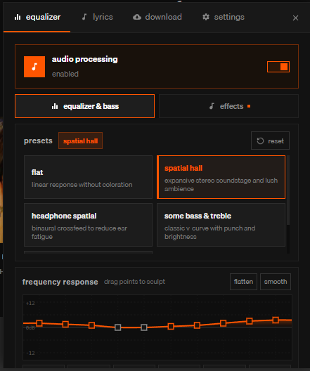
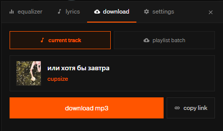

# rustcloud

> soundcloud desktop client built with tauri v2, rust, and vue 3.

---

## comparison

most desktop clients for soundcloud fall into two categories:

1. **electron clients** ([Soundnode](https://github.com/Soundnode/soundnode-app), [BetterSoundCloud](https://github.com/AlirezaKJ/BetterSoundCloud), [electronic-cloud](https://github.com/fresnodev/electronic-cloud)):
   - bundle chromium + node.js runtimes, taking 500-900 mb ram on background playback.
   - rely on webview html5 audio or `soundmanager2`.
   - no audio routing, dsp, or offline caching.

2. **webview wrappers** ([zxcloli666/SoundCloud-Desktop](https://github.com/zxcloli666/SoundCloud-Desktop)):
   - inject custom stylesheets and discord rpc on top of the soundcloud web player.
   - no audio pipeline control, equalizer, or downloader.

**rustcloud** renders the ui in a webview, while audio decoding, filters, stream resolution, proxy routing, and tagging run in rust.

---

| feature                   |                rustcloud                | [SoundCloud-Desktop](https://github.com/zxcloli666/SoundCloud-Desktop) | [BetterSoundCloud](https://github.com/AlirezaKJ/BetterSoundCloud) | [Soundnode](https://github.com/Soundnode/soundnode-app) |
| :------------------------ | :-------------------------------------: | :--------------------------------------------------------------------: | :---------------------------------------------------------------: | :-----------------------------------------------------: |
| **runtime**               |           **tauri v2 + rust**           |                          tauri v2 + react 19                           |                             electron                              |                   electron + angular                    |
| **ram usage (playback)**  |   **~40 - 80 mb, lightweight inject**   |                              ~80 - 140 mb                              |                           ~500 - 800 mb                           |                        ~600+ mb                         |
| **audio backend**         |       **yes (`rodio` + `cpal`)**        |                            no (html5 audio)                            |                         no (html5 audio)                          |                  no (`soundmanager2`)                   |
| **audio effects**         |  **10-band eq, reverb, stereo width**   |                                   no                                   |                                no                                 |                           no                            |
| **downloader & tagger**   | **yes (hls / mp3 + id3v2 + cover art)** |                                   no                                   |                                no                                 |                           no                            |
| **synced lyrics**         |                   yes                   |                                  yes                                   |                                no                                 |                           no                            |
| **proxy routing**         |   **yes (socks5 / http via `ureq`)**    |                    no, only using zapret for bypass                    |                                no                                 |                           no                            |
| **discord rich presence** |           **yes (rust rpc)**            |                                  yes                                   |                          yes (js plugin)                          |                           no                            |
| **system media controls** |     **yes (`souvlaki` smtc/mpris)**     |                                 basic                                  |                               basic                               |                         legacy                          |

---

## features

### audio engine



- **10-band equalizer:** 32 hz, 64 hz, 125 hz, 250 hz, 500 hz, 1 khz, 2 khz, 4 khz, 8 khz, 16 khz.
- **stereo width:** mid/side processing.
- **reverb:** adjustable room size and damping.
- **speed & pitch:** nightcore and daycore modes.
- **device switching:** dynamic audio device selection without restarting playback.

### downloader



- download tracks, sets, and playlists.
- mp3 and hls stream support.
- id3v2.3 tags (title, artist, album, year) with cover art.

### lyrics


- timestamped lrc lyrics.
- single-line overlay above trackbar.
- lyrics tab synced to playback.

### desktop integration

- **discord rich presence:** track, artist, album art, and playback state.
- **media controls:** media keys and osd via `souvlaki` (smtc/mpris).
- **proxy support:** socks5 and http proxy routing.

---

## limitations

- user stories are not supported.

---

## building & development

### setup

```bash
git clone https://github.com/dest4590/rustcloud.git
cd rustcloud

npm install
npm run tauri dev
```

### release build

```bash
npm run tauri build
```

binaries and bundles are generated in `src-tauri/target/release/bundle/`.
